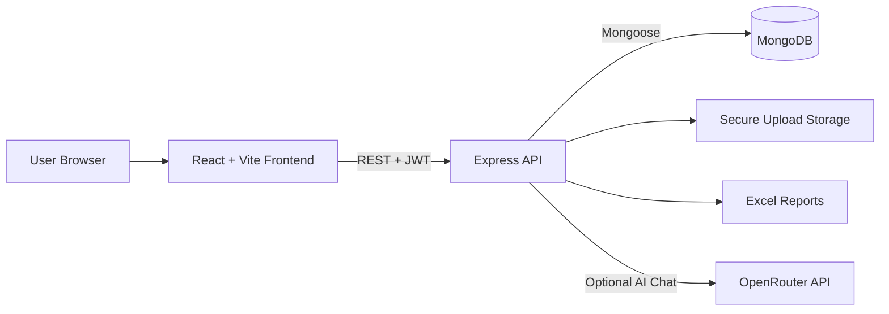
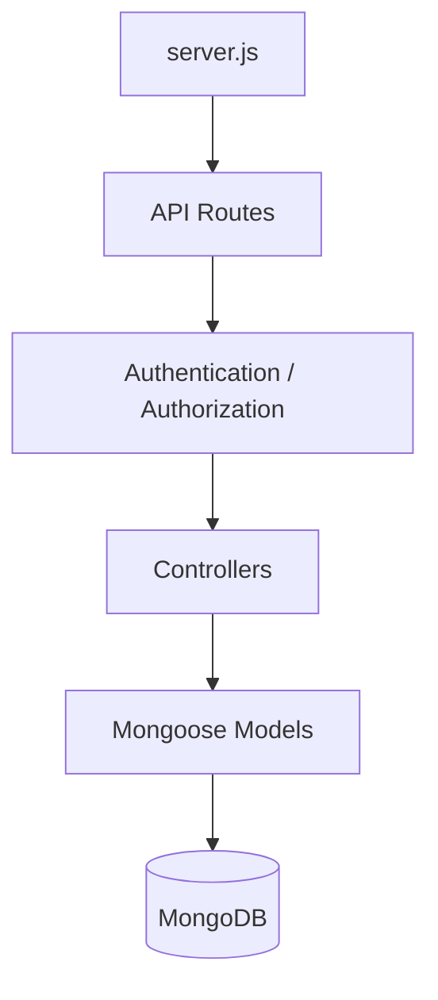
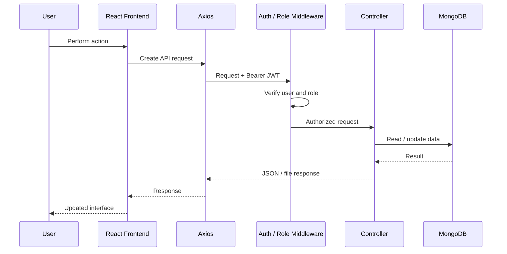
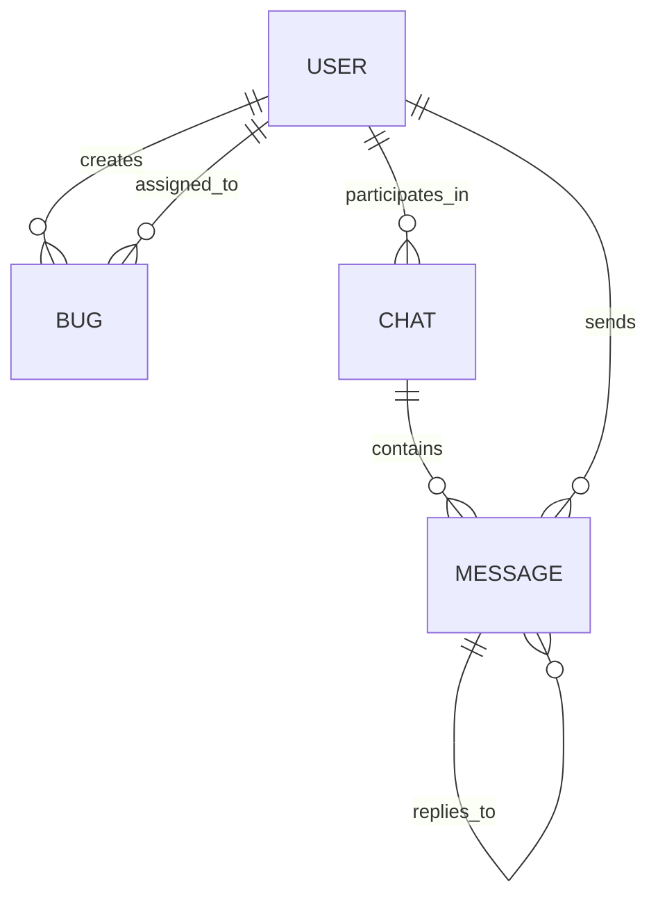
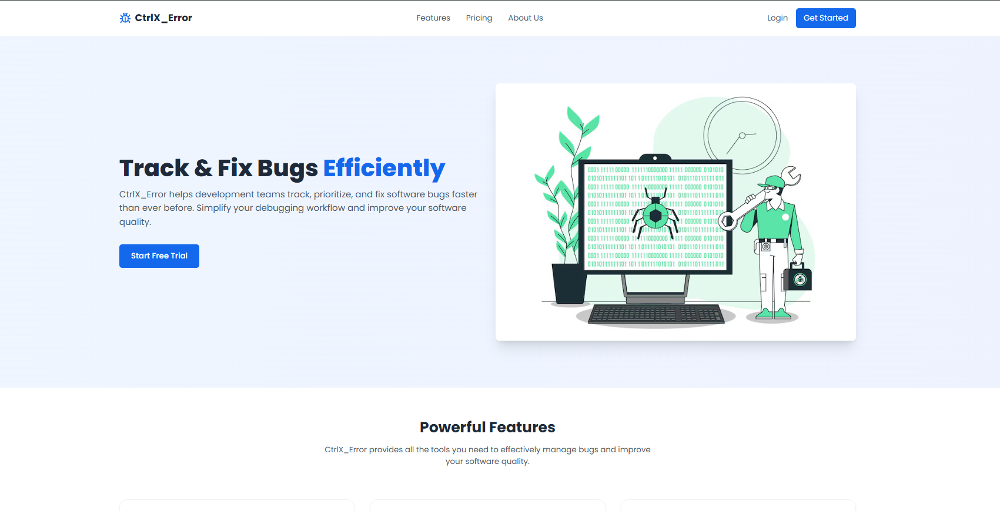
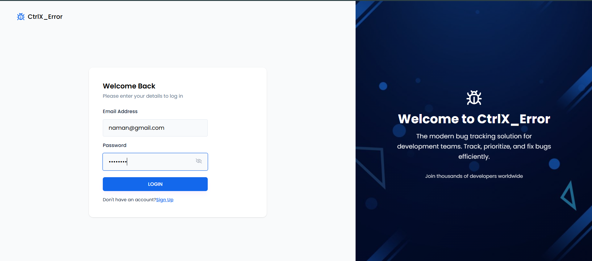
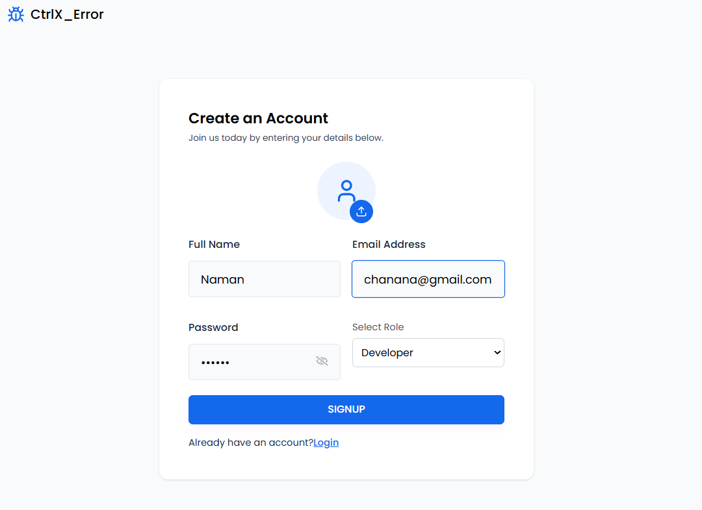

<div align="center">

# CtrlX_Error

### Full-Stack Bug Tracking & Team Collaboration Platform

[](https://ctrl-x-error.vercel.app/)
[](https://github.com/Rishy-09/CtrlX_Error/actions/workflows/ci.yml)
[](https://www.figma.com/design/wF8zt2Kh5jmG3qMGbCKIPv/Smriti?node-id=0-1)
[](https://react.dev/)
[](https://expressjs.com/)
[](https://www.mongodb.com/)
[](LICENSE)

**A MERN-based issue-management system with role-based workflows for administrators, testers, and developers — including dashboards, reporting, secure uploads, team chat, and optional AI-assisted conversations.**

</div>

---

## Overview

**CtrlX_Error** is a full-stack bug tracking and project collaboration application designed around the software-testing lifecycle.

The platform separates responsibilities across three roles:

| Role | Primary Workflow |
| --- | --- |
| **Administrator** | Manage users and bugs, monitor dashboards, assign work, export reports |
| **Tester** | Report bugs, inspect issues, monitor submitted bugs |
| **Developer** | Review assigned bugs, update status and checklist progress |

The system combines a **React/Vite frontend**, **Express REST API**, **MongoDB/Mongoose persistence**, **JWT authentication**, role-based authorization, Excel reporting, secure file uploads, chat, and optional OpenRouter-powered AI responses.

### Application Flow

```text
Tester reports bug
       ↓
Admin reviews / manages issue
       ↓
Developer receives assignment
       ↓
Checklist + status updates
       ↓
Dashboards / reports reflect progress
       ↓
Team collaboration through chat
```

---

## Key Features

### Authentication & Role-Based Access

- User registration and login
- JWT-based authentication
- bcrypt password hashing
- Authenticated profile retrieval and updates
- Role-aware frontend routing
- Backend role authorization
- Admin registration protected by an invite token
- Authentication checks for profile-image uploads
- Deleted/non-existent users rejected even when an old JWT remains valid

Supported roles:

```text
admin · tester · developer
```

### Bug Management

- Create and manage bug reports
- Role-filtered bug visibility
- Detailed bug views
- Priority and severity classification
- Developer assignment
- Due dates and modules
- Status tracking
- Developer checklists
- Bug update history
- Admin deletion controls
- Role-specific dashboard statistics

Bug classification includes:

```text
Priority: Low · Medium · High
Severity: Minor · Major · Critical
Status:   Open · In Progress · Closed
```

### Dashboards & Reporting

- Admin dashboard
- Tester dashboard
- Developer dashboard
- Bug-status summaries
- Priority/severity visualization
- Recent-bug tables
- Excel bug-report exports
- Excel user/bug summary exports

### Team Chat

- Create and manage chats
- Chat participants and administrators
- Send and retrieve messages
- Paginated message history
- Read tracking
- Message attachments
- Optional AI-assistant responses through OpenRouter

Chat attachments are authenticated and restricted to supported file types with upload-size limits.

### Secure Uploads

Profile-image and chat upload flows include authentication and upload restrictions.

Runtime uploads are stored under:

```text
backend/uploads/
```

Generated upload files are excluded from version control.

### Frontend

- Responsive landing page
- Login and signup
- Role-specific dashboards
- Bug cards and tables
- Reusable form components and modals
- Recharts visualizations
- Toast notifications
- Shared chat interface
- Protected routes
- Vercel Speed Insights

---

## Tech Stack

| Area | Technologies |
| --- | --- |
| **Frontend** | React 19, Vite, React Router, Tailwind CSS |
| **Backend** | Node.js, Express 5 |
| **Database** | MongoDB, Mongoose |
| **Authentication** | JWT, bcryptjs |
| **API Client** | Axios |
| **State** | React Context API |
| **Charts** | Recharts |
| **Uploads** | Multer |
| **Reports** | ExcelJS |
| **AI Integration** | OpenRouter |
| **Deployment** | Vercel frontend |
| **Automation** | GitHub Actions |
| **License** | GNU GPL v3 |

---

## System Architecture



The frontend handles application state, protected navigation, forms, dashboards, and API communication.

The Express backend performs authentication, authorization, validation, bug operations, user operations, reporting, chat handling, uploads, and external-service integration.

MongoDB stores persistent application data through Mongoose models.

---

## Repository Structure

```text
CtrlX_Error/
│
├── .github/
│   ├── workflows/
│   │   └── ci.yml
│   └── pull_request_template.md
│
├── backend/
│   ├── config/
│   │   └── db.js
│   │
│   ├── controllers/
│   │   ├── authController.js
│   │   ├── bugController.js
│   │   ├── chatController.js
│   │   ├── reportController.js
│   │   └── userController.js
│   │
│   ├── middlewares/
│   │   ├── auth.js
│   │   ├── authmiddleware.js
│   │   └── uploadMiddleware.js
│   │
│   ├── models/
│   │   ├── Bug.js
│   │   ├── Chat.js
│   │   ├── Message.js
│   │   └── User.js
│   │
│   ├── routes/
│   │   ├── authRoutes.js
│   │   ├── bugRoutes.js
│   │   ├── chatRoutes.js
│   │   ├── reportRoutes.js
│   │   └── userRoutes.js
│   │
│   ├── services/
│   │   └── aiService.js
│   │
│   ├── uploads/
│   │   └── .gitkeep
│   │
│   ├── package.json
│   └── server.js
│
├── frontend/
│   ├── public/
│   ├── src/
│   │   ├── assets/
│   │   ├── components/
│   │   │   ├── Cards/
│   │   │   ├── Charts/
│   │   │   ├── Inputs/
│   │   │   ├── chat/
│   │   │   └── layouts/
│   │   ├── context/
│   │   ├── hooks/
│   │   ├── pages/
│   │   │   ├── Admin/
│   │   │   ├── Auth/
│   │   │   ├── Developer/
│   │   │   └── Tester/
│   │   ├── routes/
│   │   ├── utils/
│   │   ├── App.jsx
│   │   ├── index.css
│   │   └── main.jsx
│   ├── package.json
│   ├── vercel.json
│   └── vite.config.js
│
├── docs/
├── screenshots/
├── .env.example
├── CONTRIBUTING.md
├── LICENSE
└── README.md
```

---

## Backend Architecture

The Express backend follows a route → middleware → controller → model structure.



### Route Groups

| Module | Base Route | Purpose |
| --- | --- | --- |
| Authentication | `/api/auth` | Registration, login, profiles, profile uploads |
| Users | `/api/users` | User/developer discovery and management |
| Bugs | `/api/bugs` | Dashboards, CRUD, assignments, status/checklists |
| Reports | `/api/reports` | Excel exports |
| Chat | `/api/chats` | Chats, messages and attachments |

---

## Frontend Architecture

The frontend is a React single-page application built with Vite.

### State

React Context is used for:

- authenticated user state
- token/session handling
- chat list and active chat
- message state
- chat loading/error states

### Routing

Public routes include:

```text
/
/landing
/login
/signup
```

Role-specific areas include:

```text
/admin/*
/tester/*
/developer/*
```

Protected routes validate the current authenticated user and allowed roles before rendering restricted pages.

### API Communication

Axios handles frontend-to-backend communication.

Authenticated requests attach:

```http
Authorization: Bearer <token>
```

`401` responses trigger session cleanup and redirect the user to login.

The chat API base URL can be configured through:

```env
VITE_API_URL=http://localhost:8000/api
```

---

## Request Lifecycle



---

## Authentication & Authorization

Authentication uses signed JWTs.

During login or registration:

1. User credentials are validated.
2. Passwords are hashed or compared using bcrypt.
3. The backend creates a JWT.
4. The frontend stores the token.
5. Protected requests send the token in the `Authorization` header.
6. Backend middleware verifies the token.
7. The corresponding user is loaded from MongoDB.
8. Requests from deleted/non-existent users are rejected.
9. Role middleware applies additional authorization where required.

The current roles are:

```text
admin
tester
developer
```

---

## Database

MongoDB persistence is implemented with Mongoose.

| Model | Purpose |
| --- | --- |
| `User` | Account, role and profile information |
| `Bug` | Issue details, assignment, checklist, status, attachments and history |
| `Chat` | Participants, admins, metadata and AI settings |
| `Message` | Messages, attachments, replies, reactions and read state |

### Relationships



---

## API Overview

### Authentication

| Method | Endpoint | Access | Purpose |
| --- | --- | --- | --- |
| `POST` | `/api/auth/register` | Public | Register user |
| `POST` | `/api/auth/login` | Public | Authenticate user |
| `GET` | `/api/auth/profile` | Private | Retrieve current profile |
| `PUT` | `/api/auth/profile` | Private | Update current profile |
| `POST` | `/api/auth/upload-image` | **Private** | Upload profile image |

### Users

| Method | Endpoint | Access | Purpose |
| --- | --- | --- | --- |
| `GET` | `/api/users` | Admin | Get users and bug statistics |
| `GET` | `/api/users/developers` | Admin / Tester | Get developers |
| `GET` | `/api/users/:id` | Private | Get user |

### Bugs

| Method | Endpoint | Access | Purpose |
| --- | --- | --- | --- |
| `GET` | `/api/bugs/admin-dashboard` | Admin | Admin dashboard |
| `GET` | `/api/bugs/tester-dashboard` | Tester | Tester dashboard |
| `GET` | `/api/bugs/developer-dashboard` | Developer | Developer dashboard |
| `GET` | `/api/bugs` | Private | Role-filtered bugs |
| `GET` | `/api/bugs/all-viewable` | Private | Bugs visible to user |
| `GET` | `/api/bugs/user/:userId` | Private | Bugs created by user |
| `GET` | `/api/bugs/assigned` | Developer | Assigned bugs |
| `GET` | `/api/bugs/:id` | Private | Bug details |
| `POST` | `/api/bugs` | Tester | Create bug |
| `PUT` | `/api/bugs/:id` | Private | Update bug |
| `DELETE` | `/api/bugs/:id` | Admin | Delete bug |
| `PUT` | `/api/bugs/:id/status` | Developer | Update status |
| `PUT` | `/api/bugs/:id/checklist` | Developer | Update checklist |

### Reports

| Method | Endpoint | Access | Purpose |
| --- | --- | --- | --- |
| `GET` | `/api/reports/export/bugs` | Admin | Export bug report |
| `GET` | `/api/reports/export/users` | Admin | Export user report |

### Chat

All chat routes require authentication.

| Method | Endpoint | Purpose |
| --- | --- | --- |
| `POST` | `/api/chats` | Create chat |
| `GET` | `/api/chats` | Get current user's chats |
| `GET` | `/api/chats/:id` | Get chat |
| `PUT` | `/api/chats/:id` | Update chat |
| `DELETE` | `/api/chats/:id` | Delete chat |
| `POST` | `/api/chats/:id/messages` | Send message / attachments |
| `GET` | `/api/chats/:id/messages` | Retrieve messages |

Chat attachments currently accept:

```text
JPEG · PNG · WebP · PDF · plain text
```

with a maximum of **5 attachments** and **5 MB per file**.

---

## Quick Start

### Prerequisites

- Node.js 20 recommended
- npm
- MongoDB connection

### 1. Clone

```bash
git clone https://github.com/Rishy-09/CtrlX_Error.git
cd CtrlX_Error
```

### 2. Install backend dependencies

```bash
cd backend
npm install
```

### 3. Install frontend dependencies

```bash
cd ../frontend
npm install
```

---

## Environment Configuration

Use [`.env.example`](.env.example) as the reference for local configuration.

Create the required local environment file without committing real secrets.

Typical configuration includes:

```env
PORT=5000
MONGO_URI=mongodb://localhost:27017/ctrlx_error
JWT_SECRET=replace-with-a-strong-secret
ADMIN_INVITE_TOKEN=replace-with-an-admin-invite-token

CLIENT_ORIGINS=http://localhost:5173,http://localhost:3000

OPENROUTER_API_KEY=
APPLICATION_URL=http://localhost:5000

VITE_API_URL=http://localhost:5000
```

### CORS

`CLIENT_ORIGINS` controls which frontend origins may access the backend.

Multiple origins can be supplied as a comma-separated list:

```env
CLIENT_ORIGINS=http://localhost:5173,https://your-frontend.example.com
```

Requests from tools without an `Origin` header, such as curl or Postman, remain usable for development/API testing.

> Never commit `.env` files, JWT secrets, database credentials, API keys, or admin invite tokens.

---

## Running Locally

### Backend

```bash
cd backend
npm run dev
```

Production-style start:

```bash
npm start
```

### Frontend

```bash
cd frontend
npm run dev
```

Production build:

```bash
npm run build
```

Preview:

```bash
npm run preview
```

---

## Security

CtrlX currently implements:

- bcrypt password hashing
- JWT authentication
- role-based authorization
- protected frontend routes
- admin registration invite token
- authenticated profile-image uploads
- authenticated chat routes
- profile-image MIME validation
- chat attachment MIME restrictions
- chat attachment file-size limits
- user-existence verification after JWT decoding
- environment-controlled CORS
- secrets through environment variables
- runtime uploads excluded from Git

### Dependency Maintenance

The frontend dependency audit currently resolves to **0 known vulnerabilities** after safe dependency updates.

The backend dependency tree has also been substantially updated. A small number of moderate transitive findings may remain through the Excel export dependency chain.

Breaking dependency upgrades are intentionally not forced without validation.

### Current Security Considerations

Potential future hardening includes:

- request rate limiting
- centralized input validation/sanitization
- centralized Express error handling
- moving browser authentication away from `localStorage` where appropriate
- malware/content scanning for uploaded files
- additional automated security testing

---

## Validation & CI

GitHub Actions validates pushes and pull requests targeting `main`.

### Frontend

CI performs:

```bash
npm ci
npm run build
```

### Backend

CI performs dependency installation and JavaScript syntax validation across the backend source.

Local frontend validation:

```bash
cd frontend
npm run build
```

Local backend validation:

```bash
node --check backend/server.js

find backend/controllers backend/middlewares backend/models backend/routes backend/services \
  -type f -name "*.js" -print0 | xargs -0 -n1 node --check
```

The project currently contains some pre-existing ESLint cleanup debt, primarily unused variables and React Hook/Fast Refresh warnings. Lint is therefore not yet used as a blocking CI gate.

---

## Screenshots

### Landing Page



### Authentication



<br>



Additional dashboard/chat screenshots can be added as the project evolves.

---

## Deployment

### Frontend

The React frontend includes Vercel SPA routing configuration and is deployed at:

**https://ctrl-x-error.vercel.app/**

### Backend

The Express backend requires a Node.js-compatible deployment environment with:

- MongoDB connectivity
- configured environment variables
- persistent or external upload storage where required

Backend deployment infrastructure is intentionally environment-specific and is not currently committed as a platform-specific configuration.

---

## Current Maintenance Notes

The repository has undergone a maintenance pass covering:

- secure CORS configuration
- authenticated profile uploads
- restricted chat attachments
- stronger JWT/user validation
- dependency security updates
- removal of committed runtime uploads
- removal of duplicate/dead frontend code
- environment configuration template
- automated CI
- contribution guidance

Remaining non-critical maintenance opportunities include:

- resolving existing frontend lint debt
- consolidating duplicate authentication middleware
- frontend code splitting to reduce the main production bundle
- adding automated backend/frontend behavioral tests
- centralized API validation
- pagination improvements for large bug lists

---

## Future Work

Potential extensions include:

- automated backend API tests
- frontend component/integration tests
- centralized Express error handling
- request-schema validation
- rate limiting
- consolidated authentication middleware
- consistent environment-driven API configuration across all frontend clients
- frontend lazy loading and code splitting
- additional dashboard/chat screenshots
- backend deployment templates
- generated OpenAPI documentation
- seed/setup tooling for development users

---

## Contributing

Contributions are welcome.

See [`CONTRIBUTING.md`](CONTRIBUTING.md) for development setup, validation, security guidance, and pull-request expectations.

A pull request template is also provided under `.github/`.

---

## License

CtrlX_Error is licensed under the **GNU General Public License v3.0 (GPL-3.0)**.

See [`LICENSE`](LICENSE) for the complete license text.

---

## Authors

| Contributor | Role | Contributions |
| --- | --- | --- |
| **Soumya Jain** | Frontend Developer | UI design, React pages, Figma design |
| **Smriti Walia** | QA & Research | Bug testing, UI layout, documentation |
| **Amulya Jain** | Integration & DevOps | Frontend/backend integration, fixes, middleware, versioning |
| **Naman Chanana** | Backend & Full-Stack Lead | Authentication, backend APIs, database design, integration and testing |

---

<div align="center">

### CtrlX_Error

**Track bugs · Assign work · Collaborate · Resolve**

React · Express · MongoDB · JWT · Recharts · OpenRouter

Licensed under GPL-3.0

</div>